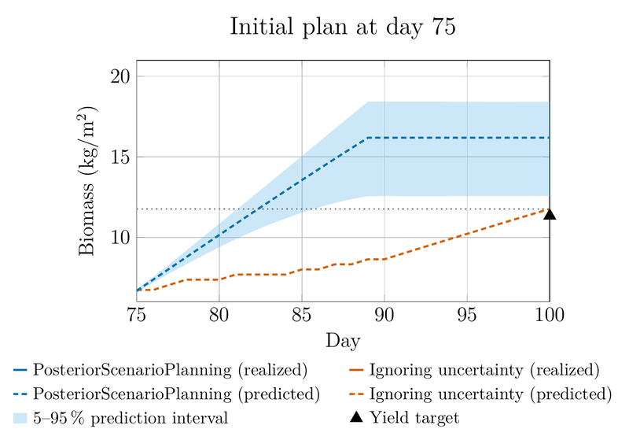

<p align="center">

</p>

**PosteriorScenarioPlanning.jl** provides a framework for **safe optimal control of unknown nonlinear systems from input–output data**, with probabilistic guarantees for constraint satisfaction.

<p align="center">

</p>

*Receding-horizon control of a vertical farm with uncertain crop parameters. The plan is recomputed as new biomass measurements arrive. Accounting for the remaining uncertainty, PosteriorScenarioPlanning (blue) reaches the yield target, whereas planning that ignores the uncertainty (orange) misses it.*

The package implements the method described in:

> **A Bayesian Framework for Safe Optimal Control of Unknown Systems from Input–Output Data**
> *Robert Lefringhausen, Annalena Daniels, Michael Fink, Sandra Hirche*
> Preprint (2026)

## Overview

Learning-based optimal control aims to operate systems with unknown dynamics by learning models from data. This is particularly relevant where accurate models are difficult or expensive to derive from first principles, for instance in biological processes. In such applications, several challenges typically arise jointly:

- **Nonlinear and stochastic dynamics**, affected by both process noise and measurement noise.
- **Latent states**, which cannot be measured directly, so that learning and control must rely on input–output data alone.
- **Scarce data**, which makes the incorporation of structural prior knowledge essential.
- **Safety requirements**, which demand that constraints are satisfied with high confidence despite the uncertainty about the dynamics and the latent states.

Existing methods typically address these challenges in isolation. PosteriorScenarioPlanning addresses them jointly. Prior knowledge is encoded in a parametric state-space model and a prior distribution over its unknown parameters and initial state. This prior is then updated using measured inputs and outputs of the system. Instead of relying on a single identified model, the package represents the joint uncertainty over the unknown dynamics and the latent states that remains given the data, and accounts for this uncertainty when computing and certifying control inputs.

The approach combines:

1. **Bayesian learning** via particle Markov chain Monte Carlo (PMCMC), which updates a prior in state-space form with input–output data and yields samples from the joint posterior over model parameters and latent state trajectories. Prior knowledge from first principles enters through the model structure and the prior.
2. **Validation with probabilistic guarantees**, where a candidate control input is evaluated on independent posterior scenarios to obtain a high-confidence upper bound on its probability of constraint violation under the posterior predictive distribution.
3. **Risk-sensitive control synthesis**, where posterior samples define a scenario-based optimal control problem with a Conditional Value-at-Risk (CVaR) penalty. The weight of this penalty, which trades off performance against robustness, is adapted automatically until the desired robustness level is certified.

The framework also supports a receding-horizon setting, in which the posterior is updated as new measurements become available, progressively reducing uncertainty and improving performance.

For detailed explanations and examples, please refer to the **[Documentation](https://TUM-ITR.github.io/PosteriorScenarioPlanning.jl/dev/)**.

## Installation

This package is not registered. Clone and instantiate it locally (Julia 1.12 or later):

```bash
git clone https://github.com/TUM-ITR/PosteriorScenarioPlanning.jl.git
cd PosteriorScenarioPlanning.jl
julia --project=. -e 'using Pkg; Pkg.instantiate()'
```

MCMC chains run in parallel across threads, so starting Julia with multiple threads (e.g. `julia -t auto`) is recommended.

## Solvers

The results reported in the paper were obtained using proprietary **HSL linear solvers** (in particular `MA97`) for improved numerical performance. HSL solvers are available from <https://www.hsl.rl.ac.uk/> and can be obtained under a free academic license; installation instructions are provided on their website.

The package itself does not depend on HSL, and the optimal control problems can in principle be solved with open-source linear solvers such as MUMPS. This configuration has not been tested, however, and may be slower or numerically less robust.

## Citation

If you use this code in your research, please cite our paper:

```bibtex
@article{lefringhausen2026bayesian,
  title   = {A Bayesian Framework for Safe Optimal Control of Unknown Systems from Input--Output Data},
  author  = {Lefringhausen, Robert and Daniels, Annalena and Fink, Michael and Hirche, Sandra},
  journal = {Preprint},
  year    = {2026}
}
```
