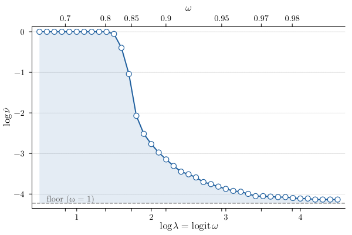

# [Calibration](@id case-study-calibration)

This page specifies the settings of the synthesis–validation loop, defined in `experiments/setup.jl`, and the preliminary analysis used to choose the initial values of the risk-weight update.

## Calibration settings

The calibration settings are summarized below; see [Choosing the Parameters](@ref parameters) for their meaning.

| Setting | Value |
|:--------|:------|
| Risk level ``\alpha`` | 0.05 |
| Acceptance band width ``\alpha_\mathrm{tol}`` | 0.015 |
| Confidence parameter ``\beta`` | ``10^{-3}`` |
| Maximum attempts ``n_\mathrm{max}`` | 8 |
| Recovery attempts ``n_\mathrm{rec}`` | 3 |
| Training scenarios ``K_\mathrm{train}`` | 400 |
| Validation scenarios ``K_\mathrm{val}`` | 5000 |
| CVaR tail level ``\tau`` | ``\alpha`` |
| Initial risk weight ``\omega_1`` | 0.8 |
| Initial elasticity ``s_\mathrm{init}`` | −2.0 |
| Elasticity cap ``s_\mathrm{flat}`` | −0.5 |
| Step bounds on ``\log \lambda`` | ``(\log 1.15, 2.0)`` |
| Margin ``m`` | 0.1 |
| Recency weighting ``\gamma`` | 0.4 |

## Risk-weight sweep

The calibration approximates the response of the violation probability to the risk weight locally by a power law, ``\log \nu \approx a + s \log \lambda`` with ``\lambda = \omega / (1 - \omega)``. `risk_weight_sweep.jl` checks this assumption and provides the initial values ``\omega_1`` and ``s_\mathrm{init}``.

On the posterior of the nominal configuration, the scenario program is solved on a grid of 41 values of ``\log \lambda`` between 0.5 and 4.5, i.e., ``\omega`` between about 0.62 and 0.99, as well as at ``\omega = 1``. Each solution is evaluated on one fixed diagnostic set of 5000 posterior scenarios. Using the same scenarios and noise realizations for all grid points (common random numbers) ensures that differences between grid points reflect the input sequence alone. The solves are warm-started along the grid.

*Logarithm of the empirical violation rate ``\hat{\nu}`` on the diagnostic set over ``\log \lambda = \mathrm{logit}\,\omega`` (bottom axis) and ``\omega`` (top axis). The dashed line marks the violation rate at ``\omega = 1``.*

The response has three regions:

- **Plateau.** For ``\omega`` below about 0.8, the CVaR term has too little weight to change the solution noticeably. The input sequence is close to the risk-neutral one, and nearly all scenarios violate the constraint (``\log \hat{\nu} \approx 0``).
- **Transition.** Between ``\omega \approx 0.8`` and ``\omega \approx 0.9``, the violation rate drops by several orders of magnitude. Here, ``\log \hat{\nu}`` decreases approximately linearly in ``\log \lambda``, which supports the local power-law model of the calibration. The slope is steepest at the beginning of the transition and flattens toward its end.
- **Floor.** For larger ``\omega``, the violation rate approaches the floor at ``\omega = 1`` (``\log \hat{\nu} \approx -4.3``, i.e., about 1.3 %), which is set by the remaining uncertainty. In this region, further increasing ``\omega`` has little effect on the violation rate.

Violation rates around the risk level ``\alpha = 5\,\%`` (``\log \hat{\nu} \approx -3``) are reached at ``\log \lambda \approx 1.9``, i.e., ``\omega \approx 0.87``, where the local slope is about −2. This value is used as the initial elasticity ``s_\mathrm{init} = -2``. The initial risk weight ``\omega_1 = 0.8`` lies at the onset of the transition region.

Since the sweep uses the nominal configuration only, the location of the transition region differs between Monte Carlo runs. The calibration therefore estimates the elasticity online from its own attempts and uses ``\omega_1`` and ``s_\mathrm{init}`` only as starting values.
