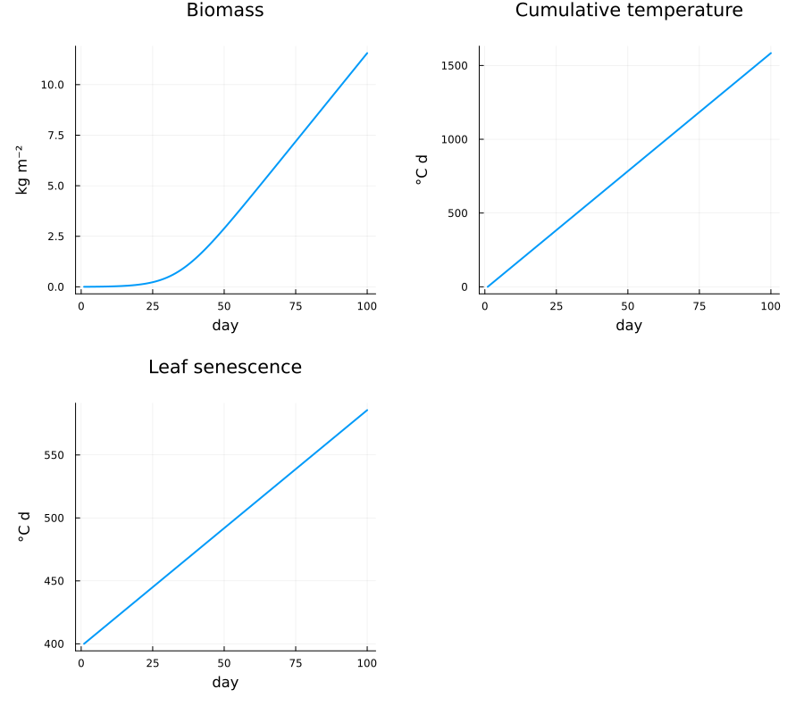
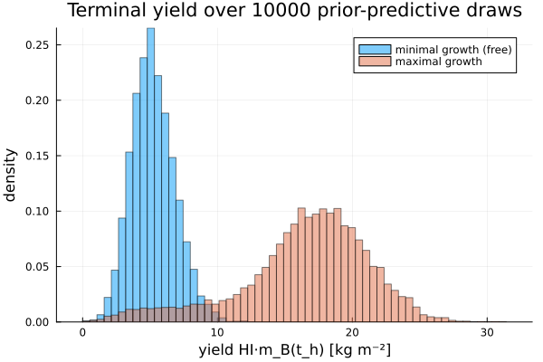

# [Crop Model and Prior](@id case-study-model)

This page describes the model ingredients of the case study: the crop model, the noise model, the uncertain parameters and their prior, and the yield target. The model and the prior are defined in `experiments/setup.jl`, and the crop model itself is implemented in `experiments/SIMPLE/`.

## SIMPLE crop model

Crop growth is described by the SIMPLE crop model ([Zhao et al., 2019](https://doi.org/10.1016/j.eja.2019.01.009)), which captures the response of crop growth to radiation, temperature, water availability, and CO₂ concentration. Unlike crop-specific models developed primarily for field or greenhouse conditions, it applies to a wide range of crops while achieving comparable accuracy for tomato, and it has previously been used for optimal control in vertical farming ([Daniels et al., 2023](https://doi.org/10.1016/j.ifacol.2023.10.666)). We use the discrete-time state-space formulation of the latter with a sampling time of one day.

The state and input are

```math
x_t = \begin{bmatrix} m_{\mathrm{B},t} & T_{\mathrm{c},t} & I_{50\mathrm{B},t} \end{bmatrix}^\top, \qquad
u_t = \begin{bmatrix} T_t & D_t & R_t & C_t \end{bmatrix}^\top,
```

| Symbol | Meaning | Unit |
|:-------|:--------|:-----|
| ``m_{\mathrm{B},t}`` | Above-ground biomass | kg m⁻² |
| ``T_{\mathrm{c},t}`` | Cumulative temperature | °C d |
| ``I_{50\mathrm{B},t}`` | Leaf senescence variable | °C d |
| ``T_t`` | Daily mean air temperature | °C |
| ``D_t`` | Drought level, i.e., relative reduction in water supply, in ``[0, 1]`` | – |
| ``R_t`` | Daily radiation | MJ m⁻² d⁻¹ |
| ``C_t`` | CO₂ concentration | ppm |

The cumulative temperature acts as a physiological clock that advances with temperature and determines the developmental stage of the crop, while the senescence variable governs the onset of senescence, i.e., the stage at which growth begins to decline. The nominal one-day transition ``\varphi_\theta(x_t, u_t)`` is

```math
\begin{aligned}
m_{\mathrm{B},t+1} &= m_{\mathrm{B},t} + R_t \, f_\mathrm{solar}(T_{\mathrm{c},t}, I_{50\mathrm{B},t}) \, \mathit{RUE} \, f_{\mathrm{CO_2}}(C_t) \, f_\mathrm{temp}(T_t) \, f_\mathrm{solar,water}(D_t) \, \min\{f_\mathrm{heat}(T_t), f_\mathrm{water}(D_t)\}, \\
T_{\mathrm{c},t+1} &= T_{\mathrm{c},t} + \max\{T_t - T_\mathrm{base}, 0\}, \\
I_{50\mathrm{B},t+1} &= I_{50\mathrm{B},t} + \max\{ I_{50\mathrm{maxW}} (1 - f_\mathrm{water}(D_t)), \; I_{50\mathrm{maxH}} (1 - f_\mathrm{heat}(T_t)) \}.
\end{aligned}
```

Biomass grows with the intercepted radiation, converted by the radiation use efficiency ``\mathit{RUE}`` and reduced by temperature, heat, drought, and CO₂ factors with values in ``[0, 1]`` (or above 1 for CO₂ enrichment). The fraction of intercepted radiation ``f_\mathrm{solar}`` rises with leaf area development and falls with senescence. Heat and drought stress accelerate senescence. For the definitions of the individual factors, see `experiments/SIMPLE/dynamics.jl` or the original publication.

Since ``T_{\mathrm{c},t}`` accumulates temperature and ``I_{50\mathrm{B},t}`` reflects accumulated heat and drought stress, the inputs affect not only the current growth rate but also the future growth potential. Higher temperatures, for example, can increase the current growth rate but also accelerate development, so that senescence begins earlier within the cultivation period and the final yield may decrease. Such trade-offs require planning over the entire remaining cultivation period.

!!! note "Implementation detail: smoothing"
    The original model contains several `min`, `max`, and clipping operations, which are non-differentiable. Since the scenario programs are solved with gradient-based interior-point methods, `experiments/SIMPLE/dynamics.jl` replaces them with smooth approximations (`smax`, `smin`, `sclip`).

## Process and measurement noise

To account for random disturbances acting on the crop, such as local fluctuations in growing conditions within the farm, the dynamics are augmented with additive Gaussian process noise,

```math
x_{t+1} = \max\left\{ \varphi_\theta(x_t, u_t) + v_t, \; 0 \right\}, \qquad v_t \sim \mathcal{N}(0, Q),
```

where the elementwise maximum keeps the states nonnegative. Only the biomass is measured,

```math
y_t = \begin{bmatrix} 1 & 0 & 0 \end{bmatrix} x_t + w_t, \qquad w_t \sim \mathcal{N}(0, \sigma_w^2),
```

for example using load cells for continuous plant weighing or image-based biomass estimation, while ``T_{\mathrm{c},t}`` and ``I_{50\mathrm{B},t}`` remain latent. Although the Gaussian measurement model may yield negative outputs when the biomass is small, the states themselves stay nonnegative.

Both noise levels are assumed to be known. The measurement noise characterizes the sensor and would in practice be obtained by sensor calibration. The levels are derived in `noise_calibration.jl` from a simulation of the SunnySD tomato cultivar under constant nominal conditions:

- **Process noise:** diagonal ``Q`` with standard deviations of about 5 % of the average daily increment of each state.
- **Measurement noise:** ``\sigma_w`` of about 5 % of the biomass after 50 days.



*State trajectories of the SunnySD tomato cultivar under constant nominal inputs, simulated by `noise_calibration.jl`. The noise levels are derived from these trajectories.*

## Uncertain parameters

The SIMPLE model has 13 parameters, for which values have been published for a range of crops and cultivars. The cultivar at hand may not be among them, and even for listed cultivars, the published values may not transfer exactly due to biological variability and differences in growing conditions. Six parameters are therefore treated as uncertain and inferred from data:

| Parameter | Meaning | Unit |
|:----------|:--------|:-----|
| ``T_\mathrm{sum}`` | Cumulative temperature requirement from sowing to maturity | °C d |
| ``I_{50\mathrm{A}}`` | Cumulative temperature requirement for leaf area development to intercept 50 % of radiation | °C d |
| ``T_\mathrm{base}`` | Base temperature for development and growth | °C |
| ``T_\mathrm{opt}`` | Optimal temperature for biomass growth | °C |
| ``\mathit{RUE}`` | Radiation use efficiency | kg MJ⁻¹ m⁻² |
| ``S_\mathrm{water}`` | Sensitivity of radiation use efficiency to drought | – |

Together, they govern the pace of development, the temperature response, the conversion of radiation into biomass, and the response to drought. They were selected as follows:

- **Cultivar-specific parameters.** ``T_\mathrm{sum}`` and ``I_{50\mathrm{A}}`` differ between cultivars of the same species, including the two published tomato cultivars. They are included regardless of their local sensitivity: ``T_\mathrm{sum}`` has a small local elasticity at the nominal values but becomes influential for cultivars whose senescence starts within the cultivation period.
- **Species-specific parameters.** A one-at-a-time sensitivity analysis of the terminal yield (`sensitivity_analysis.jl`) perturbs each parameter by ±5 % around the published tomato values under nominal conditions and computes its elasticity. ``T_\mathrm{base}``, ``T_\mathrm{opt}``, ``\mathit{RUE}``, and ``S_\mathrm{water}`` have absolute elasticities between 0.26 and 1.30, whereas those of the remaining species-specific parameters are below ``10^{-3}``.

The results of the sensitivity analysis are summarized below. The elasticity is the relative change of the terminal yield divided by the relative change of the parameter; the last two columns give the relative change of the yield for a parameter increase and decrease by 5 %.

| Parameter | Elasticity | Yield change at +5 % | Yield change at −5 % | Treatment |
|:----------|-----------:|---------------------:|---------------------:|:----------|
| ``T_\mathrm{opt}`` | −1.305 | −6.10 % | +6.95 % | inferred |
| ``f_\mathrm{solar,max}`` | 1.003 | +5.02 % | −5.02 % | known (management choice) |
| ``\mathit{HI}`` | 1.000 | +5.00 % | −5.00 % | known (not identifiable) |
| ``\mathit{RUE}`` | 1.000 | +5.00 % | −5.00 % | inferred |
| ``S_{\mathrm{CO_2}}`` | 0.946 | +4.73 % | −4.73 % | known (identical across cultivars) |
| ``S_\mathrm{water}`` | −0.600 | −3.00 % | +3.00 % | inferred |
| ``I_{50\mathrm{A}}`` | −0.489 | −2.45 % | +2.44 % | inferred (cultivar-specific) |
| ``T_\mathrm{base}`` | −0.258 | −1.31 % | +1.27 % | inferred |
| ``T_\mathrm{sum}`` | 0.003 | +0.01 % | −0.03 % | inferred (cultivar-specific) |
| ``I_{50\mathrm{maxW}}`` | ``-1.3 \cdot 10^{-4}`` | < 0.01 % | < 0.01 % | known |
| ``T_\mathrm{max}`` | 0 | 0 | 0 | known |
| ``T_\mathrm{ext}`` | 0 | 0 | 0 | known |
| ``I_{50\mathrm{maxH}}`` | 0 | 0 | 0 | known |

Three parameters with a large elasticity are nevertheless treated as known: the harvest index ``\mathit{HI}`` only scales the yield and cannot be identified from biomass measurements, the maximum radiation interception ``f_\mathrm{solar,max}`` depends on the planting density, which is a management choice, and the CO₂ sensitivity ``S_{\mathrm{CO_2}}`` is identical across all reference cultivars. All parameters outside ``\theta`` are set to their published values for the SunnySD tomato cultivar (see `get_f_theta` in `setup.jl`). The initial senescence ``I_{50\mathrm{B},0}`` is also cultivar-specific but is an initial condition and therefore part of ``x_0`` rather than ``\theta``.

## Prior

The prior represents the knowledge available before the cultivation cycle. Since published parameterizations exist for only two tomato cultivars, they are augmented with those of five cultivars of legume species with similar growth characteristics. Of the 22 published parameter sets, cool-season crops (wheat, potato, carrot), C4 plants (maize, sweetcorn), and tropical crops (rice, cassava, banana, cotton) are excluded. The seven reference cultivars are:

| Species | Cultivars |
|:--------|:----------|
| Tomato | SunnySD, Agriset761 |
| Soybean | Bragg, Williams82 |
| Dry bean | Porrillo Sintetico |
| Green bean | Bronco Habit 1 |
| Peanut | FLORUNNER |

For each component of ``\theta``, an independent Gaussian prior is constructed from the sample mean and standard deviation across these seven cultivars and truncated at zero, since all parameters are physically nonnegative (`compute_priors.jl`). This yields a conservative prior based directly on the variability across the published values, without additional assumptions about the variability within tomato cultivars.

| Parameter | Mean | Standard deviation |
|:----------|-----:|-------------------:|
| ``T_\mathrm{sum}`` [°C d] | 2478.57 | 475.97 |
| ``I_{50\mathrm{A}}`` [°C d] | 527.14 | 99.95 |
| ``T_\mathrm{base}`` [°C] | 6.29 | 1.70 |
| ``T_\mathrm{opt}`` [°C] | 26.86 | 0.69 |
| ``\mathit{RUE}`` [kg MJ⁻¹ m⁻²] | ``0.94 \cdot 10^{-3}`` | ``0.14 \cdot 10^{-3}`` |
| ``S_\mathrm{water}`` [–] | 1.44 | 0.87 |

The prior of the initial state ``x_0`` consists of independent components:

- **Biomass:** lognormal with a small mean, ``\log m_{\mathrm{B},0} \sim \mathcal{N}(\log 0.001, 0.5^2)``, representing the seed weight.
- **Cumulative temperature:** zero at sowing by definition (Dirac prior).
- **Senescence variable:** truncated Gaussian with mean 378.57 °C d and standard deviation 146.79 °C d, constructed from the published cultivar values in the same way as for ``\theta``.

In the Monte Carlo study, the true parameters and initial state of every run are drawn from this prior (`truth_from_prior = true` in `setup.jl`), so that the assumption underlying the guarantee holds by construction.

## Yield target

At harvest, a minimum yield of ``Y_\mathrm{min} = 8`` kg m⁻² must be reached. The planning problem is only informative if this target is neither reached without effort nor out of reach for most crops. `yield_threshold.jl` checks both ends on 10 000 prior-predictive realizations: each crop is simulated up to ``t_0`` under the random data-collection inputs and then until harvest under two constant input profiles,

- **minimal growth:** ambient temperature, full drought, no radiation, ambient CO₂, and
- **maximal growth:** temperature at the crop's ``T_\mathrm{opt}``, no drought, maximal radiation, and maximal CO₂,

driven by the same noise realization. The target is chosen such that it is rarely met under minimal growth and rarely missed under maximal growth.



*Distribution of the terminal yield over 10 000 prior-predictive realizations under the minimal-growth and maximal-growth input profiles, computed by `yield_threshold.jl`.*
