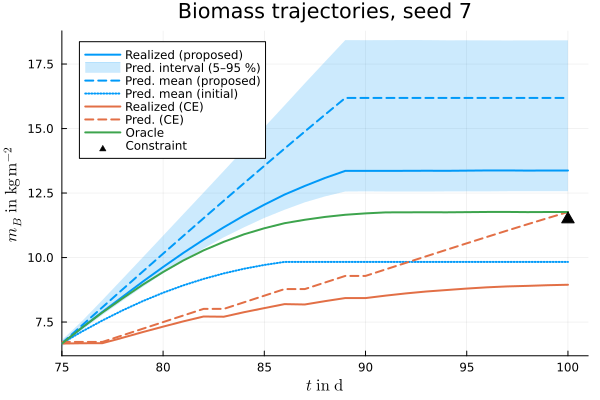

# [Open-Loop Results](@id case-study-open-loop)

In the open-loop setting, all methods plan the remaining 25 days until harvest once at ``t_0 = 75``, based on the data collected up to that point, and the plan is applied without replanning. This page first walks through a single representative run and then summarizes the results of the Monte Carlo study.

## A representative run

The methods of a single run are split into two scripts, both of which run one seed (seed 7 by default, set at the top of each script):

- **`posterior_planning.jl`** runs the proposed method, the certainty-equivalent planner, and the hindsight oracle on the same realization. It prints the calibration attempts, the certified bound, and the realized yields and costs of all three methods, and plots the biomass trajectories and the planned inputs. This script is the recommended entry point to the code: it contains the complete workflow from posterior sampling via [`run_staged_mcmc!`](@ref) to the certified plan via [`plan!`](@ref).
- **`prior_planning.jl`** runs the prior-based planner on the same realization.

Since the two scripts run independently, each prints and plots only its own methods. For the Monte Carlo study, both are run for every seed, and `montecarlo/analyze_open_loop.jl` loads the results of both scripts for selected seeds, prints them jointly, and reproduces the biomass figure below.

In the run shown here (seed 7), the initial attempt at ``\omega_1 = 0.8`` predicts a mean terminal biomass below the target. The calibration therefore raises the risk weight, and the second attempt certifies that the violation probability is at most 4.44 %, which lies within the acceptance band. The certified plan reaches the target on the true system.

The certainty-equivalent plan predicts that the target is reached but misses it on the true system, since it neglects the remaining uncertainty. The prior-based planner fails to certify any candidate: even its most risk-averse candidate at ``\omega = 1`` only attains a bound of 8.26 %, above ``\alpha = 5\,\%``.

*Biomass trajectories of seed 7. Solid lines show the trajectories realized on the true system, dashed lines the predictions, and the shaded area the 5–95 % interval of the posterior predictive distribution under the certified plan. The dotted line shows the predicted mean of the initial attempt. The triangle marks the terminal biomass required to meet the yield target. The certified plan reaches the target, whereas the certainty-equivalent (CE) plan misses it despite predicting otherwise.*

## Monte Carlo results

Over all ``R = 200`` runs, the methods compare as follows.

| Method | Plan found | Violations | Median ``J / J_\mathrm{oracle}`` |
|:-------|:-----------|:-----------|:-----------------------|
| Proposed | 155/200 (certified) | 0/155 | 1.24 |
| Prior-based | 0/200 (certified) | – | – |
| CE | 191/200 (feasible) | 119/191 | 1.00 |
| Oracle | 192/200 (feasible) | – | 1 |

Violations are counted among runs with a plan. The cost ratios are medians of the per-run ratios to the oracle over the 155 runs in which the proposed, CE, and oracle planners all find a plan.

**Certification.** The proposed method certifies a plan in 155 runs, with a median certified bound of 4.0 %. In 90 % of these runs, the bound lies within the acceptance band. In the remaining 45 runs, no plan is certified even with the most risk-averse candidate, presumably because the remaining uncertainty is too large to reach the target with sufficient probability. These include all 8 runs in which even the oracle finds no feasible plan within the input constraints, although, since the oracle problem is solved only locally, this does not strictly imply that the target is unattainable. Not certifying a plan is the intended behavior rather than a failure: the method signals before execution that the required robustness cannot be certified, allowing the operator to react, e.g., by adjusting the target, instead of applying a plan with unknown risk.

**Empirical check of the guarantee.** None of the 155 certified plans violates the yield constraint on the true system. Based on these independent runs alone, the violation probability among certified plans has a 95 % upper confidence bound of 1.9 %, below the prescribed ``\alpha = 5\,\%``.

**Baselines.** The prior-based planner certifies no plan, since the prior uncertainty over the parameters and the current state is too large. The CE planner, which neglects the remaining uncertainty, misses the target in 119 of 191 runs (62.3 %), far above ``\alpha``.

**Cost of the guarantee.** The certified plans cost 24 % more than the oracle in the median, since they must reach the target with high probability across all crops consistent with the data, whereas the oracle plans for the true one only.

**Computation time.** One planning step takes 108 min on average on 8 cores of an AMD EPYC 7402 processor: 99 min for PMCMC sampling, including the fresh validation sets, and 9 min for solving the scenario programs. Since the chains run independently, the sampling time decreases with the number of available cores. Even with this modest allocation, the computation time of less than two hours is well below the one-day interval between successive control inputs.
