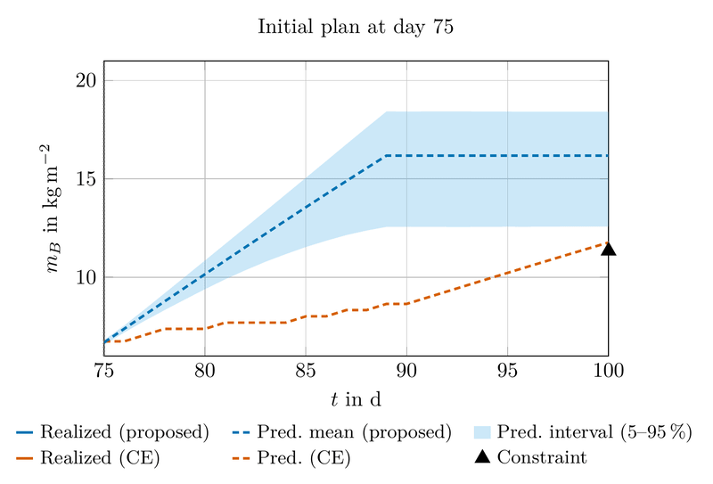
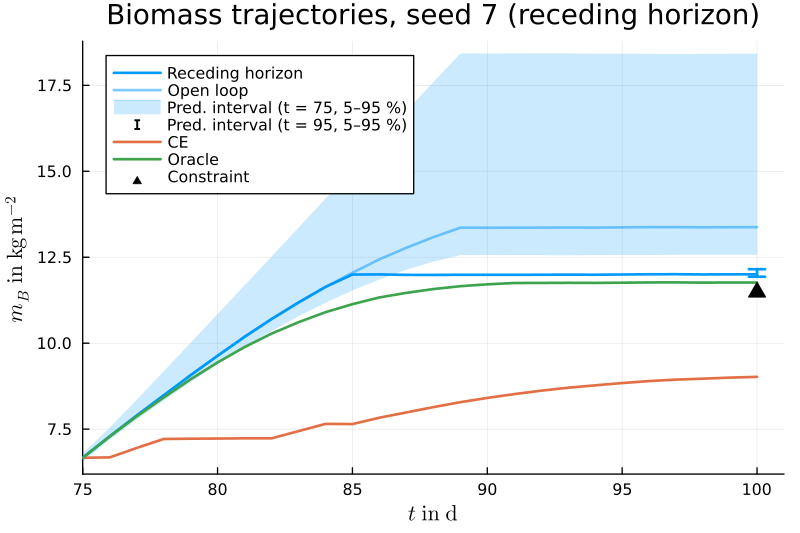

# [Receding-Horizon Results](@id case-study-receding-horizon)

In the receding-horizon setting, the plan is recomputed as new measurements arrive, so that later inputs are chosen with less uncertainty (see [Receding-Horizon Planning](@ref method-receding-horizon)). The experiment is implemented in `experiments/receding_horizon.jl`, which runs the proposed method, its first plan applied in open loop, the certainty-equivalent planner, and the hindsight oracle for a single seed.

## Setup

Starting at ``t_0 = 75``, the plan is recomputed every ``L = 5`` days, resulting in 5 control cycles until harvest. As the yield requirement refers to the fixed harvest date, the scheme is applied in its shrinking-horizon form with ``H_i = t_\mathrm{h} - t_i``. Between cycles, each chain is continued from its previous sample with an additional burn-in of 300 iterations, and the calibration is initialized with the risk weight and elasticity estimate of the previous cycle.

The first cycle coincides with the open-loop planning step (see [Open-Loop Results](@ref case-study-open-loop)). The evaluation is restricted to the 155 runs certified at ``t_0``, as in the remaining runs the method already signals before execution that the required robustness cannot be certified. If certification fails in a later cycle, the candidate with the smallest bound is applied until the next cycle. The CE planner is likewise replanned every ``L`` days and applies the remaining portion of its last feasible plan if replanning fails.

## A representative run

The animation and the figure below show the same run as on the [Open-Loop Results](@ref case-study-open-loop) page (seed 7). As new measurements become available, the uncertainty about the terminal biomass decreases considerably: the 5–95 % predictive interval of the last cycle at ``t = 95`` is much narrower than the interval of the first plan at ``t_0 = 75``. The receding-horizon planner exploits the reduced uncertainty to adapt its inputs, so that the realized yield exceeds the target by only about 2 %, compared with about 14 % for the open-loop plan, which has to hedge against the larger uncertainty at ``t_0``. The CE planner, in contrast, initially plans without any margin for uncertainty. By day 90, the measurements reveal that the crop has fallen behind its predicted growth trajectory, and the planner fails to find an input sequence that reaches the target within the input constraints. Consequently, the target is missed despite replanning.

*Control cycles of seed 7. At each replanning time, the realized trajectories up to that time are shown together with the predictions of the current plans of the proposed method and the CE planner, and the 5–95 % interval of the posterior predictive distribution under the certified plan. The last frame shows the realized trajectories until harvest.*

*Biomass trajectories of seed 7 under receding-horizon planning. Solid lines show the trajectories realized on the true system under the receding-horizon plan, the first plan applied in open loop, the CE planner, and the oracle. The shaded area shows the 5–95 % interval of the posterior predictive distribution under the certified plan at ``t_0 = 75``, and the error bar the corresponding interval of the terminal biomass under the certified plan of the last cycle at ``t = 95``. The triangle marks the terminal biomass required to meet the yield target.*

## Monte Carlo results

| Method | Plan in all cycles | Violations | Median ``J / J_\mathrm{oracle}`` |
|:-------|:-------------------|:-----------|:-----------------------|
| Proposed | 153/155 (certified) | 0/155 | 1.14 |
| CE | 143/155 (feasible) | 113/155 | 1.00 |

Violations are counted over all 155 runs, including those in which no new plan is found in a later cycle. The cost ratios are medians of the per-run ratios to the oracle over all 155 runs.

Of the 155 runs certified at ``t_0``, all subsequent cycles are certified in 153, and none of the 155 runs violates the yield constraint. Compared with the open-loop results, replanning reduces the median cost ratio to the oracle from 1.24 to 1.14: as new measurements arrive, the predictive uncertainty of the terminal biomass narrows, and the planner exploits this to approach the target more closely. The CE planner, in contrast, still misses the target in 113 of 155 runs despite replanning, since each new plan again neglects the remaining uncertainty.

**Computation time.** Over the 155 evaluated runs, the first cycle, which coincides with the open-loop planning step, takes 89 min on average (compared with 108 min over all 200 runs including those without a certified plan), whereas subsequent cycles take 73 min, a reduction of 17 %. The mean number of synthesis–validation attempts, each requiring a fresh validation set, decreases by 9 %. Despite the growing dataset, the sampling time decreases by 15 %, from 83 min to 71 min, i.e., by more than the number of attempts, which indicates that warm-starting the PMCMC chains reduces the sampling effort per cycle. The time spent solving the scenario programs decreases from about 6 min to about 3 min, reflecting the warm-started optimization but also the shorter planning horizons.

## Summary

The case study shows that uncertainty quantification and learning play complementary roles in the framework. Explicitly accounting for the remaining uncertainty is necessary to satisfy the constraint reliably and enables its certification, as the CE planner shows. Learning from data, both before planning and through posterior updates during operation, makes certification attainable without excessive conservatism, as the prior-based planner shows, and reduces the cost of robustness over time. The computational effort remains well below the one-day interval between successive control inputs.
