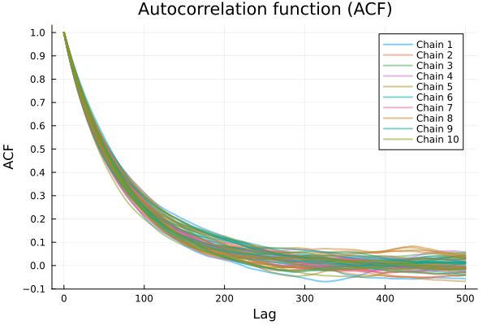
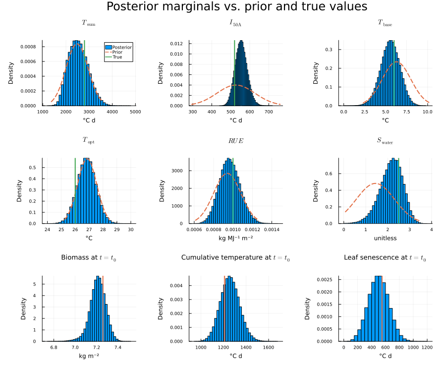
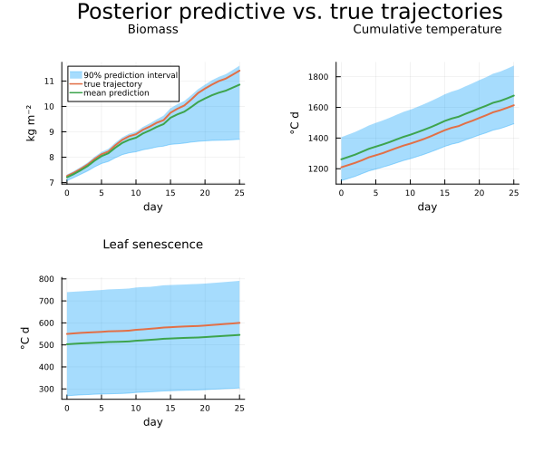

# [Sampler Tuning](@id case-study-sampler)

Posterior samples of the parameters and latent states are generated with a PMMH sampler using a bootstrap particle filter (see [Posterior Inference](@ref method-inference)). The validation guarantee assumes that these samples are independent draws from the posterior, which requires an appropriate tuning of the sampler. The sampler settings are chosen based on empirical diagnostics, computed by `sampler_tuning.jl` on the nominal configuration.

## Settings

The sampler is configured in `experiments/setup.jl`:

| Setting | Value | Purpose |
|:--------|:------|:--------|
| Mode | `Standard()` | Proposes ``\theta`` only; the initial state is marginalized by the particle filter |
| Initial proposal | Gaussian with the prior variances, scale 1 | Starting point for the adaptation |
| Staging | 5 data points per stage, 20 000 samples per intermediate stage | Incorporates the 75 data points gradually |
| Burn-in | 500 iterations per stage | Discards the initial transient of each chain in every stage |
| Thinning | 300 iterations | Spacing of successive draws from the same chain |
| Step-size adaptation | [`RobbinsMonro`](@ref), target acceptance rate 0.234 | Scale of the proposal within a stage |
| Covariance adaptation | [`GaussianCovAdaptation`](@ref) | Shape of the proposal between stages |
| Particle adaptation | [`NAdaptation`](@ref): 20–200 particles, target variance of the log-likelihood estimate 1.2 | Particle count between stages |
| Number of chains | ``K_\mathrm{train} + K_\mathrm{val} = 5400`` | One independent chain per scenario |

Since each scenario comes from its own chain, the scenarios within one set are independent by construction, and thinning only matters when a chain is continued: between calibration attempts, when fresh validation sets are drawn, and between control cycles in the receding-horizon setting. Each candidate depends on the previous validation outcomes through the risk-weight update, so a new validation set is only independent of the candidate if the chains have decorrelated in the meantime.

## Diagnostics

In the planning experiments, each chain contributes only a single sample, which does not reveal how the chains behave over time. For tuning, `sampler_tuning.jl` therefore runs 10 long chains with 10⁵ samples each, using the same settings as above but without thinning. The plots show the six parameters and the three states at the planning time ``t_0``.

### Trace plots

Trace plots show the sampled values of each variable over the iterations. For a well-tuned sampler, the traces of all chains should fluctuate rapidly around a common level, without long-term trends, which would indicate that the chains have not yet reached the posterior, and without differences between chains, which would indicate that they explore different regions. The appearance of the traces also reflects the proposal: flat segments, in which a chain stays at the same value for many iterations, indicate that too many proposals are rejected, e.g., because the steps are too large or the likelihood estimate is too noisy, whereas slow, smooth wandering indicates that the steps are too small.

*Trace plots of the six parameters and the three states at ``t_0`` for all 10 chains.*

The traces of all variables fluctuate around a stable level from the first retained iteration on, the chains overlap, and neither flat segments nor slow drifts are visible. This indicates that the burn-in is sufficient and that the step size and the particle count are adequate.

### Convergence statistic

The visual impression is complemented by the Gelman–Rubin statistic ``\hat{R}``, which compares the variance between the chains with the variance within the chains. Values close to 1 indicate that all chains sample the same distribution, and values below 1.05 are commonly considered sufficient. The table reports the largest value over all parameters, together with the final acceptance rate.

| Diagnostic | Value |
|:-----------|------:|
| Maximum ``\hat{R}`` | 1.0016 |
| Final acceptance rate | 22.12 % |

The maximum ``\hat{R}`` lies well below 1.05, confirming that the chains have converged to the same distribution after the burn-in of 500 iterations per stage. The final acceptance rate is close to the target of 23.4 % of the step-size adaptation.

### Autocorrelation and thinning

Successive samples of a chain are correlated. Within one scenario set, this does not matter, since every scenario comes from its own chain. When a chain is continued to produce a fresh validation set, however, the new sample must be approximately independent of the previous one. The thinning, i.e., the number of iterations between two retained samples of the same chain, is therefore chosen from the empirical autocorrelation function: it should be large enough that the autocorrelation at this lag has decayed to zero up to its estimation noise.

*Empirical autocorrelation functions of all variables for the 10 chains, up to lag 500.*

The autocorrelation decays to about 0.2 at a lag of 100 to 150 and approaches zero between lags of 200 and 300 for all variables and chains. Beyond this point, the curves fluctuate around zero with an amplitude that reflects the estimation noise of the autocorrelation rather than remaining correlation. A thinning of 300 iterations is therefore chosen, which lies safely within this region.

### Posterior

The posterior marginals show how much the data reduce the uncertainty compared with the prior.

*Posterior marginals of the six parameters and the three states at ``t_0`` (histograms), compared with the prior (dashed) and the true values (vertical lines). For the states at ``t_0``, no prior is shown, since their prior results from propagating the prior over ``(\theta, x_0)`` through the stochastic dynamics and is not available in closed form.*

Compared with the prior, the data are informative about some parameters but not about others:

- The posterior of ``I_{50\mathrm{A}}`` is considerably narrower than its prior.
- The posterior of ``S_\mathrm{water}`` is shifted away from the prior mean toward the true value, and those of ``T_\mathrm{base}`` and ``\mathit{RUE}`` are narrower than their priors.
- The posteriors of ``T_\mathrm{sum}`` and ``T_\mathrm{opt}`` remain close to their priors. For ``T_\mathrm{sum}``, this is consistent with its negligible local sensitivity under nominal conditions.

For all parameters and states, the true value lies within the inferred posterior.

The posterior predictive check propagates 1000 posterior samples over the planning horizon under the inputs of the realization and compares the predictions with the true trajectories.

*Posterior predictive distribution of the three states over the 25-day planning horizon: 90 % prediction interval, mean prediction, and true trajectory.*

The true trajectories lie within the 90 % prediction intervals over the whole horizon. The interval of the biomass widens considerably toward harvest, with a pronounced lower tail, so that the terminal biomass, and with it the yield, is highly uncertain at the planning time. Planning on the mean prediction alone would not account for this tail.
