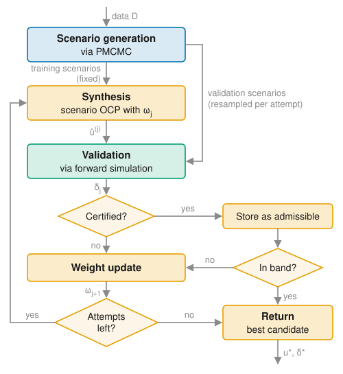

# [Overview](@id method-overview)

This section summarizes the method implemented in the package. It is intended as a guide to the code rather than a substitute for the paper, which contains the full derivations, assumptions, and proofs.

## Problem setting

Consider a nonlinear discrete-time dynamical system

```math
\begin{aligned}
x_{t+1} &= f_\theta(x_t, u_t, v_t), \\
y_t &= g_\theta(x_t, u_t) + w_t,
\end{aligned}
```

with state ``x_t \in \mathbb{R}^{n_x}``, input ``u_t \in \mathbb{R}^{n_u}``, and output ``y_t \in \mathbb{R}^{n_y}``. The state is not measured; only the output is available for learning and feedback. The functions ``f_\theta`` and ``g_\theta`` belong to a known parametric model class, while the parameters ``\theta`` are unknown. The process noise ``v_t \sim \mathcal{V}_\theta`` and measurement noise ``w_t \sim \mathcal{W}_\theta`` are i.i.d. over time, mutually independent, and independent of the initial state; their distributions may depend on ``\theta``.

Prior knowledge enters in two ways: through the structure of ``f_\theta`` and ``g_\theta``, for instance derived from first principles, and through prior distributions ``p(\theta)`` and ``p(x_0 \mid \theta)``. The true parameters and initial state are assumed to be realizations drawn from these priors.

Given a dataset ``\mathcal{D} = (u_{0:t_0-1}, y_{0:t_0-1})`` of past inputs and outputs, a prediction horizon ``H``, and a cost function ``J(u_{t_0:t_0+H}, x_{t_0:t_0+H}, y_{t_0:t_0+H})``, the goal is to find an input sequence ``u_{t_0:t_0+H}`` in a compact set of admissible inputs that minimizes the expected cost subject to the chance constraint

```math
\mathbb{P}\left[ h(u_{t_0:t_0+H}, x_{t_0:t_0+H}, y_{t_0:t_0+H}) \leq 0 \right] \geq 1 - \alpha,
```

where ``\alpha \in (0, 1)`` is the admissible risk level. The probability is taken with respect to the joint uncertainty over parameters, latent states, and future disturbances that remains given the data ``\mathcal{D}``. For multiple constraints ``h_1, \ldots, h_M``, the chance constraint is understood jointly: a trajectory violates it if at least one of the constraints is violated, which corresponds to ``h = \max(h_1, \ldots, h_M)``. The validation step bounds the violation probability in this joint sense.

## Workflow

The framework proceeds in three steps, which correspond to the three layers of the package:

1. **[Posterior inference](@ref method-inference).** PMCMC generates samples from the joint posterior over the parameters and latent state trajectories. Together with sampled future noise, each sample forms a *scenario*: a realization of the uncertainty that, for any given input sequence, fully determines a future trajectory.
2. **[Synthesis and calibration](@ref method-synthesis).** A set of training scenarios defines a risk-sensitive scenario program, whose solution is a candidate input sequence. A risk weight ``\omega`` trades off expected cost against tail risk and is adapted across attempts.
3. **[Validation](@ref method-validation).** Each candidate is evaluated on a fresh, independent set of validation scenarios. The number of observed constraint violations yields a high-confidence upper bound ``\delta`` on the violation probability. The loop terminates once a candidate certifies the desired risk level.

In the **[receding-horizon setting](@ref method-receding-horizon)**, these steps are repeated as new measurements arrive, with posterior and optimization warm-started from the previous cycle.



*Overview of the approach. Training and validation scenarios are generated from PMCMC posterior samples. In attempt ``j``, a candidate input sequence is synthesized from the training scenarios with risk weight ``\omega_j`` and evaluated on a fresh validation set, yielding a high-confidence bound ``\delta_j`` on its violation probability. The risk weight is updated until a candidate is certified within the acceptance band or the attempt budget is exhausted. Colors indicate scenario generation (blue, [Posterior Inference](@ref method-inference)), validation (green, [Validation and Certification](@ref method-validation)), and synthesis and calibration (orange, [Synthesis and Calibration](@ref method-synthesis)).*

## Mapping to the code

| Step | Main types and functions |
|:-----|:-------------------------|
| Model and data | [`DiscreteTimeStochasticSSM`](@ref), [`DiscreteTimeIOData`](@ref) |
| Posterior inference | [`ParticleMMHSampler`](@ref), [`MCMCEnsemble`](@ref), [`initialize_ensemble`](@ref), [`run_staged_mcmc!`](@ref) |
| Control problem | [`OptimalControlProblem`](@ref), costs and constraints such as [`FunctionalCost`](@ref) and [`BoxStateConstraint`](@ref) |
| Synthesis | [`CVaRScenarioFormulation`](@ref), [`build_ocp_workspace`](@ref), [`solve_ocp!`](@ref) |
| Validation | [`validate_candidate`](@ref), [`clopper_pearson_bound`](@ref) |
| Calibration loop | [`AdaptiveCalibrationConfig`](@ref), [`AdaptiveCVaRPlanner`](@ref), [`plan!`](@ref) |

The open-loop experiment of the [vertical-farm case study](@ref case-study-overview), `experiments/posterior_planning.jl`, combines all of these into a complete workflow, from posterior sampling to a certified input sequence. The model, prior, and settings it uses are defined in `experiments/setup.jl`.